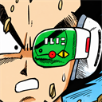

# DF Scouter

던전앤파이터 공식 홈페이지 댓글에서 원하는 캐릭터의 정보를 조회하고, 댓글과 답글을 함께 캡쳐하는 Chrome·Edge 확장프로그램입니다.

현재 버전: **2.5.0** · 던전앤파이터 비공식 팬 프로젝트

## 주요 기능

- 댓글의 **신고 · 차단** 오른쪽에 **캐릭터조회**를 표시합니다. 새로 불러온 댓글에도 표시됩니다.
- 버튼을 누른 캐릭터만 조회합니다. 같은 캐릭터가 남긴 다른 댓글에도 결과를 함께 표시하며, 댓글마다 추가 조회하지 않습니다.
- 명성, 장비점수, 직업, 장비 세트, 평균 증폭, 서약 종류·포인트, 흑아·유일장비, 모험단, 안개서약 정보를 표시합니다.
- 유일장비는 공식 프로필 아이콘 URL을 바탕으로 정밀도 구간별 아이콘을 표시합니다.
- 버튼을 누를 때마다 정보를 새로 요청하며, 조회 결과를 영구 저장하지 않습니다.
- **캡쳐**를 누르고 댓글을 선택하면 원댓글과 현재 불러온 답글을 PNG로 만들어 클립보드에 복사합니다. PNG 저장도 지원합니다.

## 설치

현재 Chrome 웹 스토어·Edge 추가 기능 스토어 배포판은 없습니다. 아래 방법으로 직접 설치합니다.

1. 이 저장소의 **Code → Download ZIP**을 눌러 내려받고 압축을 풉니다.
2. Chrome은 `chrome://extensions`, Edge는 `edge://extensions`를 엽니다.
3. **개발자 모드**를 켭니다.
4. **압축 해제된 확장프로그램 로드**를 누르고 `manifest.json`이 있는 폴더를 선택합니다.
5. 던파 공식 홈페이지의 게시글을 새로고침합니다.

설치한 폴더를 삭제하거나 이동하지 마세요. Tampermonkey는 필요하지 않습니다. 기존 **DNF 댓글 명성 표시기(DF Scouter)** 유저스크립트를 함께 쓰고 있다면 꺼주세요. 기존 스크립트의 전체 자동조회가 함께 실행될 수 있습니다.

## 사용

**캐릭터조회:** 댓글의 캐릭터조회 텍스트를 누릅니다. 같은 서버·캐릭터의 댓글들은 한 번에 갱신되며, 이후 불러온 동일 캐릭터 댓글에도 결과가 표시됩니다. 다시 누르면 새로 조회합니다.

**캡쳐:** TOP 위의 캡쳐 버튼을 누른 뒤 댓글을 선택합니다. 답글을 선택해도 원댓글부터 포함합니다. 아직 불러오지 않은 답글은 먼저 불러와야 합니다. 취소 버튼이나 Esc를 누르면 선택 모드와 안내창이 함께 닫힙니다. 클립보드 복사가 허용되지 않으면 다시 복사하거나 PNG 저장을 이용하세요.

## 표시 기준

- 평균 증폭: 무기·칭호를 제외한 11부위 증폭 합계 ÷ 11. 강화만 된 부위와 미증폭은 0으로 계산하며, 부위 정보가 불완전하면 미확인으로 표시합니다.
- 유일장비: 우아한 기품의 향수, 영롱한 날씨의 큐브, 만병을 잉태한 역병의 심장, 광휘를 머금은 눈동자.
- 정밀도: 공식 아이콘 URL의 `0·1·2·3·100`을 `0~24%·25~49%·50~74%·75~99%·100%` 구간에 대응합니다. 아이콘에 마우스를 올리면 구간을 볼 수 있습니다. 정확한 정밀도 수치를 추정하지 않습니다.
- 조회 시각을 표시하며, 공식 사이트의 정보 반영 시점에 따라 게임 내 정보와 차이가 있을 수 있습니다.

## 업데이트

최신 파일로 기존 설치 폴더의 내용을 교체한 후, 확장프로그램 관리 화면에서 **새로고침**하고 던파 게시글도 새로고침합니다. 이 설치 방식에서는 자동 업데이트되지 않습니다.

## 데이터와 권한

캐릭터 정보는 던파 공식 사이트 `https://df.nexon.com/world/character/…`의 프로필·장비점수·모험단 응답을 사용합니다. 외부 통계 사이트는 사용하지 않습니다. 요청 과정에서 공식 사이트 로그인 세션이 사용될 수 있습니다.

- 캐릭터 조회 결과는 현재 페이지의 메모리에만 유지합니다. 페이지 새로고침 시 사라집니다.
- `storage`: 구버전의 저장 캐시 삭제용입니다. 현재 조회 결과를 저장하는 용도로 사용하지 않습니다.
- `clipboardWrite`: 사용자가 선택한 댓글 캡쳐를 클립보드에 복사합니다. 클립보드를 읽지 않습니다.
- 사이트 접근 권한: 던파 공식 페이지와 지정된 이미지·글꼴 출처를 읽어 정보와 캡쳐를 만듭니다.
- 캡쳐 이미지는 브라우저 안에서 생성합니다. 댓글이나 캡쳐 이미지를 별도의 수집 서버로 보내지 않습니다.

공식 사이트의 화면 구조나 응답이 바뀌면 조회가 실패할 수 있습니다. 캡쳐에 필요한 이미지·글꼴을 읽지 못하면 일부 요소가 빠질 수 있습니다.

## 문제 제보

[Issues](https://github.com/ww9999w/df-scouter/issues)에 브라우저 종류, 확장 버전, 재현 방법, 오류 문구를 남겨주세요. 쿠키·비밀번호·로그인 토큰은 올리지 마세요.

## 출처

던전앤파이터 및 드래곤볼 관련 이미지·명칭의 권리는 각 권리자에게 있습니다. 이 프로젝트는 넥슨·네오플 및 드래곤볼 권리자의 공식 배포물이 아닙니다. 이미지 출처는 [assets/출처.md](assets/출처.md), 확장 아이콘 설명은 [icons/출처.md](icons/출처.md)에 기록했습니다.

캡쳐에는 로컬 번들 `dom-to-image-more`를 사용합니다. 해당 라이브러리의 설명과 MIT 라이선스는 [vendor](vendor/)에 포함했습니다. 제3자 이미지와 라이브러리의 이용 조건은 각각 별개입니다.
