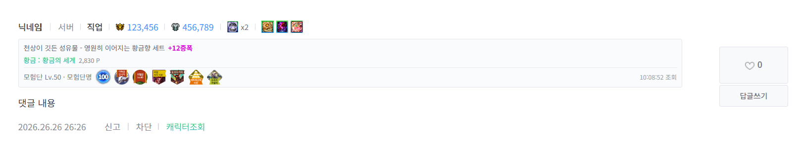

# DF Scouter

던전앤파이터 비공식 팬 프로젝트입니다.

## 소개

던파 공식 홈페이지 댓글에서 **캐릭터조회**를 누르면 명성·장비점수·장비·서약·모험단 정보를 표시하는 Chrome·Edge 확장프로그램입니다. 선택한 캐릭터만 새로 조회하며, 같은 캐릭터의 다른 댓글에도 결과를 함께 표시합니다.

댓글과 불러온 답글을 함께 캡쳐해 클립보드에 복사하거나 PNG로 저장할 수 있습니다.

## 설치 방법

1. **Code → Download ZIP**으로 내려받고 압축을 풉니다.
2. Chrome은 `chrome://extensions`, Edge는 `edge://extensions`를 엽니다.
3. **개발자 모드**를 켭니다.
4. **압축 해제된 확장프로그램 로드**를 눌러 `manifest.json`이 있는 폴더를 선택합니다.
5. 던파 게시글을 새로고침합니다.

설치한 폴더는 이동하거나 삭제하지 마세요. 기존 DF Scouter 유저스크립트를 사용 중이라면 꺼주세요.
